# SMK — Autonomous Agent-Powered E-Commerce Ecosystem

[](https://smk-tan.vercel.app/)
[](https://chatbot-service-three.vercel.app)
[](https://ecommerce-agents.onrender.com)
[](https://opensource.org/licenses/MIT)

> **SMK** is the core anchor repository of a production-grade, event-driven intelligent retail ecosystem. It combines a full-stack e-commerce application (customer storefront, checkout flow, role-protected admin dashboard) with an autonomous multi-agent inventory procurement system powered by **LangGraph**, **Apache Kafka**, and **Human-in-the-Loop (HITL)** governance, alongside a document-grounded **Qdrant RAG AI Assistant**.

---

## 🎬 System Demo Walkthrough

<video src="https://github.com/user-attachments/assets/ee9a6974-0c94-4a0e-b60c-b0a06c8a9a3c" controls="controls" muted="muted" style="max-width: 100%; width: 100%; border-radius: 8px;">
</video>

> 📹 *Watch the full end-to-end autonomous procurement flow: customer purchase triggering Kafka events, LangGraph multi-agent decisioning, Slack HITL approval, and inventory restock.*
> 
> 🔗 **Direct Demo Link:** [Watch Demo Video (GitHub Assets)](https://github.com/user-attachments/assets/ee9a6974-0c94-4a0e-b60c-b0a06c8a9a3c)  
> 🔗 **Backup Video Link:** [Watch full demonstration on Google Drive](https://drive.google.com/file/d/1sBuaMPiN2w7JuetGcy_JzI0B29fD22mz/view?usp=sharing)

---

## 🌐 Distributed Ecosystem & Source Repositories

This project operates as a distributed microservice ecosystem. SMK serves as the **primary application hub**, integrating with dedicated repositories for multi-agent procurement and knowledge-grounded AI:

| Component / Subsystem | Tech Stack | Repository | Live Deployment | Core Responsibilities |
| :--- | :--- | :--- | :--- | :--- |
| **🛍️ SMK E-Commerce Platform**<br>*(This Main Repository)* | Next.js 16, Express 5, Prisma, PostgreSQL | [Mukeshkumar9787/dams](https://github.com/Mukeshkumar9787/dams) | [smk-tan.vercel.app](https://smk-tan.vercel.app/) | Customer storefront (`web_client`), REST API server (`server`), order tracking, Razorpay checkout, Kafka event producers/consumers. |
| **🤖 Autonomous Procurement Hub** | Python 3.11, LangGraph, Kafka, FastAPI, Slack | [Mukeshkumar9787/ecommerce-agents](https://github.com/Mukeshkumar9787/ecommerce-agents) | [ecommerce-agents.onrender.com](https://ecommerce-agents.onrender.com) | Autonomous inventory velocity analysis, draft PO generation, Mock ERP telemetry, and Slack HITL interactive approval cards. |
| **💬 Intelligent RAG Chatbot Service** | Next.js 14, Qdrant Vector Cloud, Gemini AI, Sequelize | [Mukeshkumar9787/chatbot-service](https://github.com/Mukeshkumar9787/chatbot-service) | [chatbot-service-three.vercel.app](https://chatbot-service-three.vercel.app) | Knowledge base ingestion, dense vector search, sub-40ms semantic caching, security guardrails, and customer support widget. |

---

## 🏛️ Full System Architecture & Inter-Service Communication

### High-Level Topology Overview

```text
┌────────────────────────────────────────────────────────────────────────────────────────┐
│                        SMK E-COMMERCE APPLICATION (Main Repo)                          │
│                             https://smk-tan.vercel.app/                                │
│                                                                                        │
│  [Customer Checkout] ──► [Stock Decrement] ──► [Kafka Topic: inventory-events]         │
│           ▲                                                   │                        │
│           │                                                   ▼                        │
│  [Stock Restocked in DB] ◄── [Kafka Topic: inventory-restock] │                        │
└───────────────────────────────────────────────────────────────┼────────────────────────┘
                                                                │
                                                                ▼
┌────────────────────────────────────────────────────────────────────────────────────────┐
│                   AUTONOMOUS PROCUREMENT MULTI-AGENT SYSTEM (Render)                   │
│                        https://ecommerce-agents.onrender.com                           │
│                                                                                        │
│  1. 🛡️ Deterministic Zero-Token Filter (Cost optimization gate)                        │
│  2. 🧠 Supervisor Agent (LangGraph routing)                                            │
│  3. 📊 Inventory Analyst Agent (Sales velocity, burn rate, supplier terms, cap < 20)   │
│  4. 📝 Purchase Order Manager Agent (Draft PO creation)                                │
│  5. 👥 Human-in-the-Loop Approval (Slack Block Kit & Command Center UI)                │
│  6. 🚀 Automated Restock Event (Emits to inventory-restock on approval)                │
└────────────────────────────────────────────────────────────────────────────────────────┘
```

### Service-Level Architecture Diagram

```mermaid
flowchart TD
    %% Service Styling & Theme Classes
    classDef clientSvc fill:#1e293b,stroke:#38bdf8,stroke-width:2px,color:#ffffff;
    classDef appSvc fill:#0f172a,stroke:#3b82f6,stroke-width:2px,color:#ffffff;
    classDef agentSvc fill:#064e3b,stroke:#10b981,stroke-width:2px,color:#ffffff;
    classDef chatbotSvc fill:#4c1d95,stroke:#a855f7,stroke-width:2px,color:#ffffff;
    classDef dataSvc fill:#451a03,stroke:#f59e0b,stroke-width:2px,color:#ffffff;
    classDef brokerSvc fill:#3730a3,stroke:#6366f1,stroke-width:2px,color:#ffffff;
    classDef extSvc fill:#701a75,stroke:#ec4899,stroke-width:2px,color:#ffffff;

    subgraph CLIENT_TIER["1. Frontend & Client Services"]
        STOREFRONT_SVC["SMK Storefront Service (smk-tan.vercel.app)"]:::clientSvc
    end

    subgraph APP_TIER["2. Application & Backend Services"]
        ECOM_API_SVC["SMK E-Commerce API Service (Node.js / Express 5)"]:::appSvc
        CHATBOT_SVC["Intelligent RAG Chatbot Service (chatbot-service-three.vercel.app)"]:::chatbotSvc
        AGENT_HUB_SVC["Autonomous Multi-Agent Hub (ecommerce-agents.onrender.com)"]:::agentSvc
    end

    subgraph EVENT_TIER["3. Event Streaming & Messaging Service"]
        KAFKA_SVC["Apache Kafka Message Broker Service"]:::brokerSvc
    end

    subgraph DB_TIER["4. Database & Storage Services"]
        ECOM_DB_SVC[("SMK E-Commerce PostgreSQL Database Service")]:::dataSvc
        CHATBOT_DB_SVC[("Chatbot PostgreSQL Database Service")]:::dataSvc
        QDRANT_DB_SVC[("Qdrant Cloud Vector Database Service")]:::dataSvc
        ERP_DB_SVC[("Mock ERP Datastore Service")]:::dataSvc
        R2_STORAGE_SVC[("Cloudflare R2 Object Storage Service")]:::dataSvc
    end

    subgraph EXTERNAL_TIER["5. External Cloud & Gateway Services"]
        RAZORPAY_SVC["Razorpay Payment Gateway Service"]:::extSvc
        SLACK_SVC["Slack HITL Approval Service"]:::extSvc
        GEMINI_SVC["Google Gemini AI Service"]:::extSvc
        TURNSTILE_SVC["Cloudflare Turnstile Bot Protection Service"]:::extSvc
        SMTP_SVC["SMTP Mail Delivery Service"]:::extSvc
    end

    %% Client Service Connections
    STOREFRONT_SVC -->|HTTPS REST and JWT Auth| ECOM_API_SVC
    STOREFRONT_SVC -->|HTTPS SSE Chat Stream| CHATBOT_SVC

    %% E-Commerce API Service Communications
    ECOM_API_SVC -->|TCP SQL Queries via Prisma| ECOM_DB_SVC
    ECOM_API_SVC -->|Payment Order and Signature Verification| RAZORPAY_SVC
    ECOM_API_SVC -->|Deliver Email OTPs and Restock Alerts| SMTP_SVC
    ECOM_API_SVC -->|Upload and Fetch Media Assets| R2_STORAGE_SVC
    ECOM_API_SVC -->|Produce inventory-events Topic| KAFKA_SVC
    ECOM_API_SVC -.->|Internal User Role Sync Webhook| CHATBOT_SVC

    %% Autonomous Agent Hub Service Communications
    KAFKA_SVC -->|Consume inventory-events Topic| AGENT_HUB_SVC
    AGENT_HUB_SVC -->|Read and Write Purchase Orders| ERP_DB_SVC
    AGENT_HUB_SVC -->|Interactive Approval Block Kit Cards| SLACK_SVC
    SLACK_SVC -->|Manager Clicks Approve Reorder| AGENT_HUB_SVC
    AGENT_HUB_SVC -->|Produce inventory-restock Topic| KAFKA_SVC
    KAFKA_SVC -->|Consume inventory-restock Topic| ECOM_API_SVC

    %% Chatbot RAG Service Communications
    CHATBOT_SVC -->|Verify Bot Token| TURNSTILE_SVC
    CHATBOT_SVC -->|Persist Conversations and Messages| CHATBOT_DB_SVC
    CHATBOT_SVC -->|Vector Search and Semantic Cache Lookup| QDRANT_DB_SVC
    CHATBOT_SVC -->|Generate Embeddings and Grounded Answers| GEMINI_SVC
```



---

### Core Inter-Service Communication Flows

#### 1. Customer Checkout & Event-Driven Autonomous Procurement
1. **Order Verified**: Customer completes payment via Razorpay. The Express server initiates a database transaction to mark the order `PLACED` and decrement inventory in PostgreSQL.
2. **Outbound Event Dispatch**: [`inventoryAgentProducer.js`](server/services/inventoryAgentProducer.js) dispatches an event to Kafka topic `inventory-events`.
3. **Agent Ingestion & Analysis**: The external Python agent hub ([`ecommerce-agents.onrender.com`](https://ecommerce-agents.onrender.com)) consumes the event, applies a zero-token pre-filter, and triggers the `Inventory Analyst` and `PO Manager` agents using LangGraph.
4. **Human-in-the-Loop (HITL)**: An interactive Slack card is dispatched to `#procurement-alerts` alongside a web entry on the Command Center UI ([`ecommerce-agents.onrender.com`](https://ecommerce-agents.onrender.com)).
5. **Replenishment Fulfillment**: Upon approval, the agent emits a `STOCK_RESTOCK` event to Kafka topic `inventory-restock`.
6. **Stock Restored & Alerts**: [`inventoryRestockConsumer.js`](server/services/inventoryRestockConsumer.js) consumes the event, enforces business capping constraints, increments inventory via Prisma, and automatically emails customers on the waiting list.

#### 2. Live RAG Chatbot Service (`https://chatbot-service-three.vercel.app`) with Semantic Caching
1. **Client Interaction**: Storefront visitors on [`https://smk-tan.vercel.app`](https://smk-tan.vercel.app/) interact with the embedded AI assistant widget, sending queries to `https://chatbot-service-three.vercel.app/api/chat`.
2. **Rate Limiting & CAPTCHA**: Inbound queries pass through the in-memory IP rate limiter and Cloudflare Turnstile token verifier.
3. **Input Guardrail**: Evaluates query for prompt injections, credit card PII, character flooding, and excessive length.
4. **Semantic Cache Lookup**: The query is converted into a 768-dim dense vector using `gemini-embedding-2`. The cache collection `chatbot_semantic_cache` in Qdrant Cloud is evaluated:
   - **Cache Hit ($\ge 0.90$ Cosine Similarity)**: Instantly returns the cached, guardrail-sanitized answer and sources in **$\le 40\text{ms}$** with zero LLM token consumption.
   - **Cache Miss**: Qdrant Cloud retrieves grounded chunks from `store_knowledge_base`, and Google Gemini (`gemini-flash-lite-latest`) synthesizes the answer.
5. **Output Guardrail & Streaming**: The generated response is streamed chunk-by-chunk through the output guardrail (redacting leaked credentials, rewriting links to canonical `/my-account` paths, and whitelisting carrier tracking domains).
6. **Cache Upsert**: Clean answers are stored in `chatbot_semantic_cache` with a 7-day TTL.
7. **Automatic Invalidation**: Whenever an admin uploads, edits, or deletes a knowledge base document in `/api/documents`, the semantic cache is automatically purged so answers are never stale.

#### 3. Cross-Service User Role Synchronization
- When user permissions change in the primary e-commerce system (e.g., user promoted to `ADMIN`), the Express backend notifies the Chatbot service via `POST https://chatbot-service-three.vercel.app/api/sync/user-role` authenticated with `x-internal-service-key` HMAC.
- Ensures customer support and administrative knowledge policies apply consistently across both platforms.

---

### Network & Port Communication Matrix

| Service | Environment & Live Deployment | Port / Protocol | Communicates With | Role / Purpose |
| :--- | :--- | :--- | :--- | :--- |
| **🛍️ Storefront Web Client** | **Vercel**: [smk-tan.vercel.app](https://smk-tan.vercel.app/) | `3000` / HTTPS | Browser, Express API (`4000`), Chatbot Service | Customer UI, shopping cart, checkout, Flipkart-style order tracking. |
| **💬 RAG Chatbot Service** | **Vercel**: [chatbot-service-three.vercel.app](https://chatbot-service-three.vercel.app) | `8005` / HTTPS (SSE) | Storefront Widget, Qdrant Cloud (`6333`), Gemini API, PostgreSQL | RAG conversational assistant, sub-40ms semantic caching, guardrails. |
| **🤖 Autonomous Agent Hub** | **Render**: [ecommerce-agents.onrender.com](https://ecommerce-agents.onrender.com) | `8002` / HTTPS | Kafka (`9092`), Slack API, Mock ERP DB | Autonomous inventory analysis, PO drafting, Slack HITL approvals. |
| **⚙️ E-Commerce API Server** | Node.js / Express 5 | `4000` / HTTP / REST | Web Client, PostgreSQL, Kafka (`9092`), Razorpay, R2, SMTP | Core e-commerce domain API, auth, orders, catalog, audit logs. |
| **🗄️ Primary Database** | PostgreSQL 15 | `5432` / TCP | Express API Server (via Prisma ORM) | Relational persistence for orders, users, catalog, stock. |
| **📨 Apache Kafka Broker** | Kafka / KRaft | `9092` / TCP | Express Producer/Consumer, Python Agent Swarm | Distributed message broker for event-driven replenishment. |
| **🎯 Vector Database** | Qdrant Cloud (AWS sa-east-1) | `6333` / HTTPS | Chatbot Service | Pure vector storage for store knowledge base & semantic cache points. |
| **💬 Chatbot Database** | PostgreSQL (Prisma Cloud) | `5432` / TCP | Chatbot Service | Storage for conversation threads, messages, synced user roles. |

---

## Features

- Product browsing with categories, sizes, colors, HSN/tax data, stock, search/filter views, and product details
- Cart and wishlist management, including persisted user data
- Checkout with saved addresses, billing details, shipping configuration, order notes, and shipping charges
- Razorpay online payments with payment verification and payment-failure handling
- Cash-on-delivery order type in the domain model
- Customer accounts with password authentication, email OTP login/registration/password reset, and Google sign-in
- Customer order history, order details, invoices, order status history, and dispute actions
- Product reviews, review visibility controls, and out-of-stock notification requests
- Admin dashboard with product, category, size, color, HSN, user, order, company-information, courier, and shipping configuration management
- Admin order status updates and role management
- Audit logging for API activity and audit-log statistics
- Autonomous inventory agent integration: Emits low-stock Kafka events upon customer order placement and consumes agent replenishment events to automatically restock products and notify subscribed customers
- File uploads using Cloudflare R2-compatible object storage, with signed upload/download support
- Email delivery through SMTP for OTP and application messages

## Stack

### Frontend (`web_client`)

- Next.js 16 with the App Router
- React 19 and TypeScript
- Tailwind CSS, Ant Design, and custom CSS
- Redux Toolkit and React Redux for cart, wishlist, product, and UI state
- Axios for API requests
- NextAuth/Google OAuth-related integrations
- Razorpay Checkout.js for online payments

### Backend (`server`)

- Node.js with Express 5 using ES modules
- Prisma ORM 7
- PostgreSQL 15
- Apache Kafka client (`kafkajs`) for event-driven autonomous inventory replenishment
- JWT authentication, bcrypt password hashing, Joi validation, Helmet, CORS, and Morgan logging
- Razorpay server SDK for payment order creation and verification
- Nodemailer for SMTP email
- AWS SDK S3 client for R2-compatible file storage

## Project structure

```text
.
├── web_client/       # Next.js storefront and admin UI
├── server/            # Express API and Prisma schema/migrations
├── docker-compose.yml # Local PostgreSQL service
└── NOTES.md           # Project-specific development notes
```

## Requirements

- Node.js 20 or later
- npm
- Docker and Docker Compose, or an available PostgreSQL 15 database

## Local setup

1. Start PostgreSQL with Docker Compose:

   ```bash
   docker compose up -d postgres
   ```

2. Configure the API environment:

   ```bash
   cd server
   cp env.example .env
   ```

   Set at least `DATABASE_URL`, `JWT_SECRET`, `JWT_EXPIRES_IN`, `PORT`, `SERVER_ADDRESS`, and the Razorpay credentials. Configure SMTP for email/OTP functionality and R2 variables when using object-storage uploads.

3. Install API dependencies, apply Prisma migrations, and start the API:

   ```bash
   npm install
   npx prisma migrate deploy
   npm run dev
   ```

   The API is mounted under `/api`. The development frontend configuration expects `http://localhost:4000/api`; set `PORT=4000` if using that default.

4. Configure and start the frontend in a second terminal:

   ```bash
   cd web_client
   npm install
   touch .env.local
   npm run dev
   ```

   Update `NEXT_PUBLIC_API_BASE_URL` and provide the required Google and Razorpay public settings in `.env.local`.

## Environment variables

The server template is available at [`server/env.example`](server/env.example). Important server variables include:

| Variable | Purpose |
| --- | --- |
| `DATABASE_URL` | PostgreSQL connection string used by Prisma |
| `JWT_SECRET`, `JWT_EXPIRES_IN` | JWT configuration |
| `RAZORPAY_KEY_ID`, `RAZORPAY_KEY_SECRET` | Server-side Razorpay integration |
| `SMTP_HOST`, `SMTP_PORT`, `SMTP_USER`, `SMTP_PASS` | OTP and email delivery |
| `R2_*` | Optional Cloudflare R2-compatible file storage |
| `GOOGLE_CLIENT_ID` | Server-side Google token verification |
| `MOCK_ERP_URL` | URL of the autonomous procurement agent / ERP service (defaults to `http://localhost:8002`, production: `https://ecommerce-agents.onrender.com`) |
| `INVENTORY_AGENT_ENABLED` | Feature flag to enable Kafka stock event publishing & replenishment consumer (`true`/`1`) |
| `KAFKA_BOOTSTRAP_SERVERS` | Kafka broker endpoints (e.g., `localhost:9092` or managed Kafka broker) |
| `KAFKA_TOPIC_INVENTORY_EVENTS` | Kafka topic for outbound low-stock events (defaults to `inventory-events`) |
| `KAFKA_TOPIC_RESTOCK_EVENTS` | Kafka topic for inbound stock replenishment events (defaults to `inventory-restock`) |
| `KAFKA_RESTOCK_CONSUMER_GROUP_ID` | Consumer group ID for backend restock listener (defaults to `smk-backend-restock-group`) |
| `KAFKA_SECURITY_PROTOCOL`, `KAFKA_SASL_MECHANISM` | Optional Kafka SASL/SSL authentication settings for cloud brokers |
| `KAFKA_USERNAME`, `KAFKA_PASSWORD`, `KAFKA_CA_PATH` | Optional credentials & CA cert for secure Kafka connections |

The frontend uses `NEXT_PUBLIC_API_BASE_URL`, `NEXT_PUBLIC_RAZORPAY_KEY_ID`, `NEXT_PUBLIC_RAZORPAY_CHECKOUT_LINK`, `NEXT_PUBLIC_PAYMENT_TIMEOUT_SECONDS`, and `NEXT_PUBLIC_GOOGLE_CLIENT_ID`.

Do not commit real credentials or private environment files.

## 🔄 Kafka Event-Driven Autonomous Procurement Workflow

SMK integrates with an autonomous multi-agent procurement system ([`ecommerce-agents`](../ecommerce-agents)) via **Apache Kafka**. This creates a fully automated, closed-loop inventory replenishment cycle:

```text
┌────────────────────────────────────────────────────────────────────────────────────────┐
│                                   SMK STOREFRONT & BACKEND                             │
│                                                                                        │
│  [Customer Checkout]                                                                   │
│          │                                                                             │
│          ▼ (Payment Success)                                                           │
│  [Stock Decremented in DB]                                                             │
│          │                                                                             │
│          ▼ (publishInventoryEvent)                                                     │
│   Kafka Topic: `inventory-events` ────────┐                                            │
│                                           │                                            │
│                                           ▼                                            │
│                       ┌───────────────────────────────────────┐                        │
│                       │    AUTONOMOUS PROCUREMENT AGENTS      │                        │
│                       │      (`ecommerce-agents` service)     │                        │
│                       │                                       │                        │
│                       │  1. Deterministic Zero-Token Filter   │                        │
│                       │  2. Inventory Analyst (Sales Burn Rate)                        │
│                       │  3. PO Manager (Draft PO Generation)  │                        │
│                       │  4. Slack / UI Human Approval (HITL)  │                        │
│                       └───────────────────┬───────────────────┘                        │
│                                           │                                            │
│   Kafka Topic: `inventory-restock` ◄──────┘ (produce_restock_event upon approval)     │
│          │                                                                             │
│          ▼ (startRestockConsumer)                                                      │
│  [Restock Consumer: validate qty < 20]                                                 │
│          │                                                                             │
│          ▼ (productService.restockProduct)                                             │
│  [Database Stock Incremented] ───► [Trigger Customer Restock Email Notifications]      │
└────────────────────────────────────────────────────────────────────────────────────────┘
```

### 1. How Kafka Events Trigger the Workflow (Outbound Trigger)

When a customer places an order and payment is verified via Razorpay:
1. **Stock Decrement**: In [`server/services/orders.js`](server/services/orders.js), the order transitions to `PLACED` within a database transaction, decrementing product inventory.
2. **Feature Flag Check**: The backend verifies `INVENTORY_AGENT_ENABLED=true` (or `INVENTORY_AGENT=enabled`).
3. **Event Dispatch**: [`server/services/inventoryAgentProducer.js`](server/services/inventoryAgentProducer.js) dispatches an inventory level event to Kafka topic `inventory-events`:
   - Partition key: Product `slug` or `sku`.
   - Payload schema:
     ```json
     {
       "event_id": "evt-1730635200000-abc123",
       "timestamp": "2026-11-03T12:00:00.000Z",
       "sku": "classic-heavyweight-cotton-t-shirt",
       "slug": "classic-heavyweight-cotton-t-shirt",
       "product_id": 101,
       "product_name": "Classic Heavyweight Cotton T-Shirt",
       "current_stock": 4,
       "reorder_threshold": 10
     }
     ```
4. **Mock ERP Sync**: The producer also pushes an asynchronous activity record to the Mock ERP dashboard ([`https://ecommerce-agents.onrender.com/api/v1/activities`](https://ecommerce-agents.onrender.com/api/v1/activities) in production, or `http://localhost:8002/api/v1/activities` locally) so administrators see real-time order depletion on the command center monitor.

### 2. Multi-Agent Processing & Human-in-the-Loop Approval

Once published to `inventory-events`, the external [`ecommerce-agents`](../ecommerce-agents) system ingests the message:
- **Zero-Token Pre-Filter**: If remaining stock is healthy (`current_stock > reorder_threshold`) or if a draft PO is already pending for this SKU, the agent system skips processing immediately with zero LLM token cost.
- **Agent Analysis**: If stock is low (`current_stock <= reorder_threshold`), the multi-agent graph calculates the optimal replenishment quantity based on 30-day sales velocity, supplier MOQ, and lead time.
- **Draft PO & Human Approval**: The system creates a draft Purchase Order in the ERP and posts an interactive Block Kit approval card to Slack (`#procurement-alerts`) and the Command Center Web UI ([`https://ecommerce-agents.onrender.com`](https://ecommerce-agents.onrender.com) or `http://localhost:8002`). The workflow pauses for human decision (`interrupt_after=["po_manager"]`).

### 3. How the Workflow Completes (Inbound Restock Consumer)

When an authorized human clicks **"Approve Reorder"** in Slack or **"Approve"** on the Command Center UI ([`https://ecommerce-agents.onrender.com`](https://ecommerce-agents.onrender.com) / `http://localhost:8002`):
1. **PO Issuance**: The Purchase Order is updated to `ISSUED` status in the ERP.
2. **Restock Event Published**: The agent system dispatches a replenishment event to Kafka topic `inventory-restock` using [`produce_restock_event`](../ecommerce-agents/src/tools/ecommerce.py).
   - Payload schema:
     ```json
     {
       "event_id": "restock-a1b2c3d4",
       "event_type": "STOCK_RESTOCK",
       "action": "RESTOCK",
       "timestamp": "2026-11-03T12:05:00.000Z",
       "slug": "classic-heavyweight-cotton-t-shirt",
       "sku": "classic-heavyweight-cotton-t-shirt",
       "productId": 101,
       "quantity": 19,
       "po_number": "PO-9142",
       "poNumber": "PO-9142"
     }
     ```
3. **Consumer Ingestion**: On SMK server startup, [`server/services/inventoryRestockConsumer.js`](server/services/inventoryRestockConsumer.js) initiates a persistent consumer connected as consumer group `smk-backend-restock-group` subscribed to `inventory-restock`.
4. **Business Policy Enforcement**:
   - The consumer enforces the business constraint that replenishment additions per order must be strictly **less than 20 units** (capping quantity to `19` if any higher value is received).
5. **Database Stock Update**: The consumer executes [`productService.restockProduct(...)`](server/services/products.js):
   - Inserts a new `Stock` record of type `PRODUCT` with the replenished quantity into PostgreSQL via Prisma.
   - Computes updated available stock.
6. **Customer Notifications**: If the product was previously out of stock (`previousStock === 0`), `sendRestockNotifications` automatically sends back-in-stock notification emails to all customers registered on the product's waiting list.
7. **Cycle Completed**: The store catalog reflects the new inventory level in real time without requiring any manual database edits or HTTP restock endpoints.

---

## Database

The Prisma schema is at [`server/prisma/schema.prisma`](server/prisma/schema.prisma), and migration history is in [`server/prisma/migrations`](server/prisma/migrations). Useful commands from `server/`:

```bash
npx prisma generate
npx prisma migrate deploy
npx prisma studio
```

For development schema changes, follow the repository instructions in [`NOTES.md`](NOTES.md).

## Production builds

```bash
cd web_client
npm run build
npm run start
```

```bash
cd server
npm start
```

Both services include Dockerfiles and expose port `10000` in their container images. The included Compose file currently provisions PostgreSQL only; application services must be run separately or added to the Compose configuration.

## API areas

The Express API is available below `/api` and includes routes for authentication, products, categories, sizes, colors, users, addresses, files, cart, wishlist, orders, configuration, dashboard, HSN, and audit logs. Dashboard and audit-log routes are restricted to administrators.

## Status

This README describes the functionality and technology currently represented in the repository. No automated test suite is configured yet; the server `test` script is currently a placeholder.
